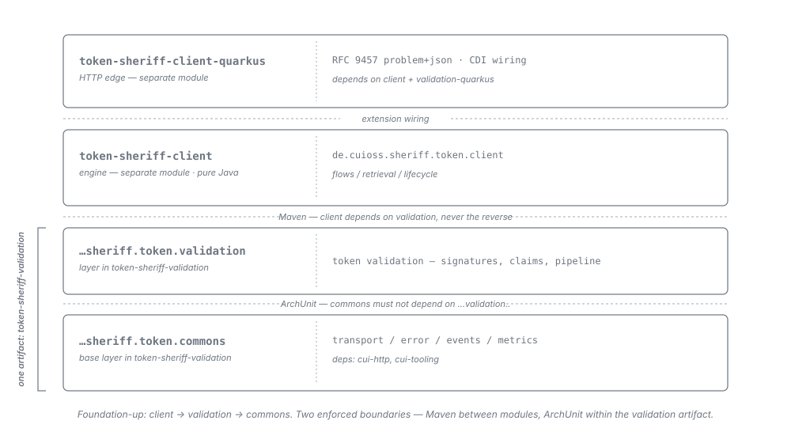
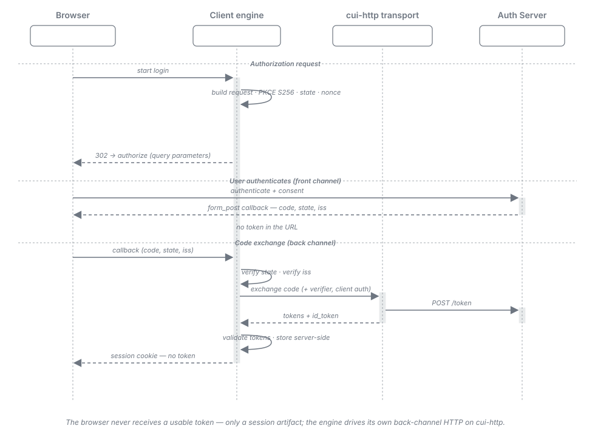

= Client Architecture
:toc: left
:toclevels: 3
:toc-title: Table of Contents
:sectnums:
:source-highlighter: highlight.js

== Overview

_See xref:requirements.adoc[Client Requirements], xref:threat-model.adoc[Threat Model],
xref:best-practices.adoc[Best Practices] and the
xref:../adr/0001-Validation_and_Client_Module_Split_with_a_Commons_Base_Layer.adoc[module-architecture decision]._

The `client` capability is the *active* OIDC side: a server-side *confidential-client engine*
that retrieves tokens, holds and refreshes them server-side, and drives the flows on top of
the xref:../commons/architecture.adoc[commons] transport. It is the engine a
*Backend-For-Frontend (BFF)* is built on — *it is not itself a BFF*. This document maps the
engine's components, its boundaries with commons and validation, and the sequences it drives.

[IMPORTANT]
====
*We do not build a BFF here.* The BFF is a separate application layered on top of this
engine. This capability's job is to specify the engine so that *building a BFF on top stays
feasible and is not made unnecessarily complicated*. The BFF deployment shapes below are
documented only as the *consumers the design must keep viable*
(xref:requirements.adoc#CLIENT-19[CLIENT-19]), not as features delivered here.
====

== Position in the module architecture

* The engine is *pure Java* (xref:requirements.adoc#CLIENT-21[CLIENT-21]) — no CDI /
  MicroProfile / JAX-RS inside it. It depends on `token-sheriff-validation`, which
  transitively provides the `commons` base layer.
* The `client → validation` dependency direction is enforced by *Maven* — the
  `token-sheriff-client` module declares the dependency; it never reverses.
* The HTTP edge (`token-sheriff-client-quarkus`, or a future RESTEasy / portal adapter) maps
  the engine's typed exceptions to `application/problem+json`
  (xref:requirements.adoc#CLIENT-20[CLIENT-20], `COMMONS-11`).

NOTE: The Maven module (`token-sheriff-client`), the `token-sheriff-client-quarkus`
extension, and the BOM/reactor assembly are in place. This document specifies the engine those
modules host.

== The engine seam

The engine owns three responsibilities and *delegates the rest*:

[cols="1,3", options="header"]
|===
| Concern | Where it lives

| *Retrieval & flow* — construct the authorization request (PKCE, `state`, `nonce`,
  `acr_values`, and the per-call options of xref:requirements.adoc#CLIENT-27[CLIENT-27]; PAR stays
  a building block (`ParClient`), and the built-in authorization-code flow also offers an opt-in
  pushed path (`AuthorizationCodeFlow.authorizePushed`) that refuses, never falls back, when no
  PAR endpoint is advertised — xref:requirements.adoc#CLIENT-10[CLIENT-10]);
  exchange the code; authenticate to the token endpoint; request
  sender-constrained tokens; drive step-up and RP-initiated logout.
| *This engine* (`client`), xref:specification/retrieval-flow.adoc[retrieval-flow] +
  xref:specification/step-up-and-logout.adoc[step-up-and-logout] specs.

| *Server-side token lifecycle* — hold, refresh (with rotation), revoke; preserve
  sender-constraint; keep tokens off the browser.
| *This engine* (`client`), xref:specification/token-handling.adoc[token-handling] spec.

| *Token trust* — signature, algorithm policy, `iss`/`aud`/`exp`/`iat`, DPoP proof.
| *validation* module (inherited; `CLIENT-15` calls it, never re-implements it).

| *Outbound OIDC/OAuth back-channel HTTP* — discovery, token, userinfo, revocation, PAR;
  TLS-scheme enforcement, in-module egress path validation and host-address egress policy,
  bounded reads, timeouts.
| *This engine* (`client`) — it performs its *own* hardened HTTP, building `cui-http`
  `HttpHandler`s directly and applying an in-module egress control uniformly through the
  shared `BackChannelHttp` helper; it does *not* route these fetches through a commons
  transport façade. JWKS retrieval and the token-signature transport stay with the
  xref:../commons/architecture.adoc[commons]-backed *validation* pipeline.

| *Error rendering* — typed exceptions → `application/problem+json`.
| Engine *throws* (`COMMONS-10`); the *HTTP edge renders* (`COMMONS-11`).
|===

The seam is deliberately narrow: the engine is the *policy* layer (which parameters, which
order, which checks) and *drives its own hardened OIDC/OAuth back-channel HTTP* on top of the
`cui-http` transport primitives (`HttpHandler`, TLS, the `de.cuioss.http.security` egress
pipeline); validation is the *trust* layer. The engine reuses commons' transport *library*,
but it does not delegate the OIDC/OAuth back-channel fetches to a commons transport service —
see xref:#_owned_back_channel_http[].

== Confidential authorization-code + PKCE sequence

The core in-scope flow (xref:requirements.adoc#CLIENT-1[CLIENT-1], server-side, no tokens in
the browser):

The *browser never receives a usable token*. What the browser holds is the BFF's own
session artifact — see xref:#_bff_binding_shapes[].

== [[_bff_binding_shapes]] BFF binding shapes (enabled, not built here)

A BFF built on this engine binds the acquired tokens to the browser session one of two ways;
in *both*, the token stays inaccessible to the browser, and the engine seam is *identical*
(xref:requirements.adoc#CLIENT-19[CLIENT-19]):

[cols="1,3", options="header"]
|===
| BFF deployment | How the token is bound to the browser session

| *Stateful BFF — server-side token store*
| The browser holds an opaque *session-id cookie*; tokens live in a *server-side store* and
  the backend *proxies* every resource-server call.

| *Stateless BFF — encrypted token cookie*
| The access token reaches the browser only inside an *HttpOnly cookie encrypted with a
  server-side symmetric key*; the backend *decrypts* it per request. No server-side store.
|===

What differs — a server-side store vs. an encrypted cookie — is the *BFF application's*
concern (session cookie, symmetric-key management, backend-API CSRF, request proxying,
login/consent UX, logout *receivers*). The engine must *enable either without forcing the
choice*; it implements neither.

== Boundaries enforced

* *Engine → validation* (Maven): the engine validates every retrieved token via the
  validation pipeline (`CLIENT-15`); it never re-implements signature/claim checks.
* *Engine owns its back-channel HTTP*: the engine drives its *own* outbound OIDC/OAuth
  back-channel HTTP (discovery, token, userinfo, revocation, PAR) on the `cui-http` transport
  library, and applies its own in-module egress control before each fetch
  (xref:#_owned_back_channel_http[]). It reuses commons' transport *primitives* (`HttpHandler`, TLS,
  the `de.cuioss.http.security` pipeline), not a commons transport *service*.
* *Engine throws, edge renders*: the pure-Java engine throws commons typed exceptions
  (`COMMONS-10`); only the HTTP edge produces problem+json (`CLIENT-20`, `COMMONS-11`).
* *Engine ≠ BFF*: the browser session / cookie layer is out of the engine entirely
  (`CLIENT-19`).

== [[_owned_back_channel_http]] Owned back-channel HTTP and its egress control

The five OIDC/OAuth back-channel clients — `DiscoveryResolver`, `TokenEndpointClient`,
`ParClient`, `UserInfoClient`, `RevocationClient` — construct and drive their *own* `cui-http`
`HttpHandler` calls rather than delegating to a commons transport service; this is a deliberate
design choice, recorded in the class javadoc.

Because a discovery document is only transport-authenticated — not fully trusted — a hostile or
mix-up-controlled AS could point a credential-bearing back-channel `POST` at an unintended
target. The engine therefore *owns* an in-module egress control, applied uniformly by the shared
`BackChannelHttp` helper before every fetch:

[cols="1,3", options="header"]
|===
| Control | What it does

| *Egress / path validation* | Each discovery-advertised endpoint URL is run through the
  `de.cuioss.http.security` URL-path validation pipeline, so a traversal / injection /
  encoding-evasion / malformed advertised path is *rejected before it is fetched*, surfacing as
  a `TransportException`.
| *Host-address egress policy* | Before every fetch the client's own `EgressPolicy`
  (`ClientConfiguration.getEgressPolicy()`, a separate instance from the validation
  transport's) resolves the host of the URL *actually contacted* — after the back-channel origin
  rewrite below — and refuses it when any resolved address is loopback, link-local (including
  the cloud-metadata range), site-local, unique-local, carrier-grade NAT, wildcard, broadcast or
  multicast. The policy is on by default; its only relaxations are the two configuration inputs
  `allowLoopbackEgress` and `allowedEgressHosts`, which apply to configured endpoints and to a
  back-channel origin exactly as to advertised ones. A refusal surfaces as a
  `TransportException`. The host is resolved at the check and again by the HTTP client when it
  connects, so a DNS answer that changes in between is not seen (the DNS-rebinding limit
  `EgressPolicy` states).
| *Back-channel origin rewrite* | When a back-channel origin is configured
  (`backChannelOrigin`, xref:requirements.adoc#CLIENT-24[CLIENT-24]), an advertised endpoint
  whose origin equals the issuer origin is rewritten to the back-channel origin, keeping its raw
  path and query verbatim; an endpoint on any other origin is contacted unchanged. The egress /
  path validation above runs on the advertised URL *before* the rewrite. Both origins in the
  comparison come from configuration alone, so the advertised URL decides only *whether* it is
  rewritten, never *where to*. A DPoP proof attached to a rewritten call names the rewritten
  target as its `htu`: the claim is the target URI of the request the proof travels with
  (RFC 9449 §4.2), so the token and userinfo clients sign the URL actually contacted, not the
  advertised one. The issuer identity, the published metadata and the front-channel URLs stay
  public (xref:../adr/0015-DPoP_htu_names_the_back-channel_URL_actually_contacted.adoc[ADR-0015]).
| *Scheme / TLS enforcement* | A non-TLS (`http://`) endpoint is refused unless cleartext is
  explicitly enabled, via the `HttpHandler` builder's TLS enforcement. Independently of that
  setting, every endpoint the client models and uses that an `https` issuer's discovery document
  advertises (`authorization_endpoint`, `token_endpoint`, `userinfo_endpoint`, `jwks_uri`,
  `end_session_endpoint`, `revocation_endpoint`, `introspection_endpoint`,
  `pushed_authorization_request_endpoint`) must be `https`; a cleartext value for one of them is
  refused by `DiscoveryResolver`, while an advertised field outside that set is not read. This control, the
  per-client trust (`sslContext`) and hostname verification are applied to the host actually
  contacted — the rewritten target when a back-channel origin applies.
| *Bounded reads & timeouts* | Response bodies are size-capped through the commons
  `BoundedBodyHandler`: a response advertising a `Content-Length` above the ceiling is refused
  before a byte of it is read, and a body that crosses the ceiling while streaming is refused at the
  crossing (see the
  xref:../commons/specification/transport.adoc#bounded_response_body[transport specification]);
  connect / read timeouts come from `ClientConfiguration`. The read timeout bounds the wait until the
  response headers arrive; whether it also bounds the body read that follows depends on the JDK
  (observed: not on JDK 21 and 25, yes on JDK 27), and on every JDK the body read is bounded in size.
|===

[IMPORTANT]
====
*Scope of the egress control.* It validates the advertised URL's *path structure and scheme*,
and it refuses a contacted host whose resolved address falls in the internal ranges listed
above, unless `allowLoopbackEgress` or `allowedEgressHosts` admits it. It does not re-check the
address the HTTP client connects to, so it does not defend against DNS rebinding between the
check and the connection; a deployment that needs that guarantee still needs network-level
egress filtering. This document states the control the client actually applies, and no more.
====

== [[_extension_points]] Extension points: subclassable entry methods

Several engine types are public and subclassable, and a relying party may override their entry
method to intercept, instrument or stub it. Every internal caller therefore calls that one method; a
new signal on its outcome rides the exception hierarchy the method already throws, as a dedicated
*subtype* of a documented thrown type, never a preferred overload
(xref:../adr/0006-A_cross-cutting_signal_on_a_public_subclassable_method_rides_subtype_exceptions_never_a_preferred_overload.adoc[ADR-0006]).
Existing `catch` clauses, `assertThrows` assertions and `@throws` contracts stay valid.

[cols="1,3", options="header"]
|===
| Signal | Carrier subtypes

| Redemption of a refused refresh (whether the server consumed the grant, and the rotated successor)
| The `Redeemed*` exceptions (`RedeemedResponseException`, `RedeemedScopeRefusalException`,
  `RedeemedValidationRefusalException`, `RedeemedIdentityRefusalException`) behind the
  `RedeemedRefreshFailure` marker; the redemption is read back as a `RefreshRedemption`
  (xref:specification/token-handling.adoc#_refresh_refusal_classification[refresh-refusal classification])

| Refused client authentication at the token endpoint
| `ClientAuthenticationFailedException`, a `TransportException`

| Refused scope (`invalid_scope`)
| `InvalidScopeException`, a `TransportException`

| Refused refresh-token family (reuse, revoked family)
| `RefreshTokenFamilyRevokedException`, a subtype of the protocol exception the family raised before
|===

Before adding an overload the production path would prefer, establish whether the existing method is
overridable and whether anything overrides it, test doubles included (`AGENTS.md` § Code Standards).

== [[_null_safety_posture]] Null-safety posture

The client packages are `@NullMarked` (JSpecify). Where a value is optional, the shape follows the
kind of API surface
(xref:../adr/0014-Optional_record_components_are_typed_nullable_while_accessor_APIs_expose_Optional.adoc[ADR-0014]):

* An optional *record component* is typed `@Nullable` and carries `null`; no `Optional` is stored.
  Example: `AuthorizationCodeFlow.AuthenticationResult.refreshToken`, and the nullable
  `RotationResult.grantedScope` and `StoredToken.subject`.
* An optional value on a *hand-written accessor* is returned as `Optional`. Example:
  `TokenResponse.getRefreshToken()` over a nullable field.
* A record's compact constructor null-rejects every component not annotated `@Nullable`.
  `AuthenticationResult` rejects a `null` `accessToken` or `idToken` and accepts a `null`
  `refreshToken`. The annotation and the check are a pair: removing one without the other silently
  widens a required component.

== Reference & replacement target: portal-authentication-oauth

[NOTE]
====
*Design reference only.* `cui-portal-core`'s
`modules/authentication/portal-authentication-oauth` is an existing confidential server-side
OIDC client (CDI + MicroProfile Config + RESTEasy/JAX-RS) — effectively a BFF-style RP that
already implements most of the in-scope flow (auth-code + PKCE `S256`, `state`, light
`nonce`, `client_credentials`, refresh, discovery, userinfo, RP-initiated logout with
`id_token_hint`; tokens held in the portal session).

It grounds this capability's scope and is the *eventual replacement target* — the engine
would supersede it via a thin portal adapter preserving the portal contract (`Oauth2Service`,
`Oauth2AuthenticationFacade`, `OauthRedirector`, `OidcRpInitiatedLogoutParams`, result type
`AuthenticatedUserInfo`; config namespace `authentication.oidc.*`). That replacement — the
adapter and its integration tests — is *future work beyond Plans 01–06*; no current plan
touches it. The modernization deltas it motivates (cryptographic ID-token validation via the
validation module, `iss` mix-up defence, `private_key_jwt` (mTLS `tls_client_auth` is alpha —
declared, never selected), PAR, DPoP sender-constraining — requesting a certificate-bound token
is not a capability the engine has, while preserving a certificate binding a token already
carries is, and that preservation is a capability distinct from mTLS client authentication and
unaffected by its alpha status — stronger `nonce`, in-module hardened
back-channel HTTP with egress path and host-address
controls) are each captured as sourced `CLIENT-N` requirements above.
====

== See also

* xref:requirements.adoc[Client Requirements] — `CLIENT-N`, grouped by aspect
* xref:threat-model.adoc[Client Threat Model]
* xref:best-practices.adoc[Client Best Practices]
* xref:specification/retrieval-flow.adoc[Retrieval & flow specification]
* xref:specification/step-up-and-logout.adoc[Step-up & logout specification]
* xref:specification/token-handling.adoc[Token-handling specification]
* xref:specification/test-strategy.adoc[Test-strategy specification]
