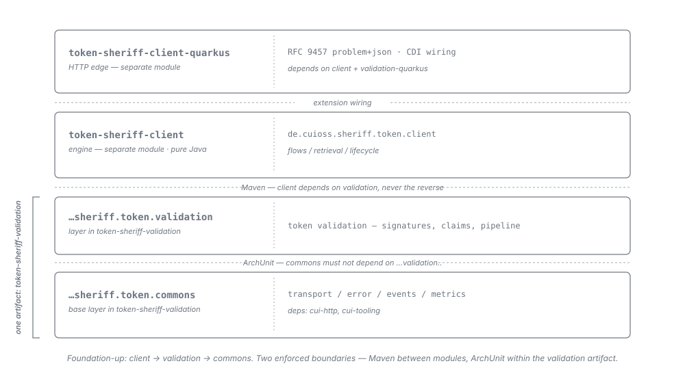

= Commons Architecture
:toc: left
:toclevels: 3
:toc-title: Table of Contents
:sectnums:
:source-highlighter: highlight.js

== Overview

_See xref:requirements.adoc[Commons Requirements], xref:threat-model.adoc[Threat Model] and
the xref:../adr/0001-Validation_and_Client_Module_Split_with_a_Commons_Base_Layer.adoc[module-architecture decision]._

`commons` is the *shared base layer* every capability sits on. It is the package root
`de.cuioss.sheriff.token.commons` — with sub-packages `transport`, `error`, `http`, `events` and
`metrics` — *shipped inside the `token-sheriff-validation` artifact*. It is **not a
separate module**: no consumer wants the base without validation (the client validates the
tokens it retrieves, so it pulls `validation` and gets the base transitively;
`nifi-extensions` wants `validation`). A `token-sheriff-commons` artifact would add a
POM / release / BOM surface nobody picks alone. The layering guarantee a module boundary
would give is instead enforced by *ArchUnit*.

== The base layer

The seam is sharp: *commons moves bytes, raises typed errors, counts events and exposes
metrics; it never interprets a token's trust.*

=== The sub-packages

[cols="1,3", options="header"]
|===
| Sub-package | Responsibility

| `commons.transport`
| The validation-side outbound IdP HTTP — discovery (`.well-known`, RFC 8414) and JWKS
  (RFC 7517) — plus the shared transport primitives: TLS enforcement, egress policy
  (`EgressPolicy`), timeouts, response-size limits (the public `BoundedBodyHandler`, also used
  by the client's back-channel reads), retry/backoff,
  the `cui-http` client, and discovery / JWKS caching. The client engine builds its *own*
  back-channel HTTP (token / userinfo / revocation / PAR) on these primitives
  (xref:../client/architecture.adoc#_owned_back_channel_http[owned back-channel HTTP]).
  See xref:specification/transport.adoc[transport spec].

| `commons.error`
| The typed exception hierarchy that library code throws, plus the inbound normalization of
  OAuth `error` / `error_description` (RFC 6749 §5.2). The RFC 9457 rendering lives at each
  HTTP edge, not here. See xref:specification/error-model.adoc[error-model spec].

| `commons.http`
| The framework-neutral RFC 6750 helpers of an HTTP edge: `BearerCredentials` reads the
  `Bearer` credentials of an `Authorization` value, and `BearerChallenge` builds the
  `insufficient_scope` challenge. They depend on `java.util` and JSpecify only and never decide
  an HTTP status. See xref:#public_helpers[].

| `commons.events`
| `SecurityEventCounter` and the security-event types, so validation and the client
  share one event surface. Thread-safe, no Micrometer dependency. See
  xref:specification/observability.adoc[observability spec].

| `commons.metrics`
| Metric identifiers / contracts (`sheriff.token.*`) defined once; edges wire them to
  Micrometer.
|===

== [[public_helpers]] Public HTTP-edge helpers

Four pieces of HTTP-edge logic are public commons classes, so every edge — the Quarkus producer, the
client, a gateway built on the library — uses one implementation
(xref:../adr/0031-Bearer_extraction_scope_challenge_sanitiser_escape_and_bounded_body_reads_are_public_commons_helpers.adoc[ADR-0031]):

[cols="1,3", options="header"]
|===
| Helper | Contract

| `commons.http.BearerCredentials`
| Reads RFC 6750 §2.1 credentials from an `Authorization` value and reports exactly one of `ABSENT`,
  `MALFORMED` or `PRESENT`. The scheme name matches case-insensitively (RFC 9110 §11.1). The value is
  trimmed of SP and HTAB; the scheme must be followed by one or more SP (a tab does not separate it, so
  such a value carries no `Bearer` credentials). An empty or whitespace-only token, and a token holding
  SP, HTAB or a control character (C0, DEL, C1), is `MALFORMED`. It checks the characters the RFC rules
  refuse, not the full `b64token` grammar; the token pipeline judges the rest. The Quarkus
  `BearerTokenProducer` maps `ABSENT` to its no-token path (cookie fallback included), `MALFORMED` to 400
  `INVALID_REQUEST` and `PRESENT` to validation.

| `commons.http.BearerChallenge`
| Builds the RFC 6750 §3.1 `insufficient_scope` challenge string; it never decides a status code. A scope
  name outside the RFC 6749 §3.3 `scope-token` grammar is refused with `IllegalArgumentException`, as is
  a set of more than 64 distinct scopes or a challenge longer than 8192 characters — the bounds of the
  client's `InsufficientScopeChallengeParser`, pinned by `InsufficientScopeChallengeRoundTripTest`.
  Scopes are written sorted with duplicates collapsed. `realm` and `error_description` are RFC 9110
  §5.6.4 quoted strings that escape `"` and `{backslash}` and refuse CR, LF, NUL, the other C0 controls and DEL.
  The builder bounds its own work: it retains at most 65 distinct scopes (still checking every further
  name), scans at most the length bound of a `realm` or `error_description`, and `build()` refuses an
  over-long value before copying it. The Quarkus extension checks the scopes of every `@BearerAuth` and
  `@BearerToken` at build time; a set that check misses is answered 500 with `TokenSheriff_Q-201`
  logged.

| `ErrorTextSanitizer.escapeNonPrintableAscii`
| The printable-ASCII form of the one commons sanitiser; see the
  xref:specification/error-model.adoc#printable_ascii_escape[error-model specification].

| `commons.transport.BoundedBodyHandler`
| The one bounded body reader, with an `OverLimitPolicy` of `FAIL` or `TRUNCATE`; see the
  xref:specification/transport.adoc#bounded_response_body[transport specification]. A `TRUNCATE` caller
  must read `BoundedBodyHandler.BoundedBody.truncated()`.
|===

== [[archunit]] ArchUnit boundary

The layering is enforced by ArchUnit rules living in `token-sheriff-validation`'s test
sources — giving the same guarantee a module boundary would, with one fewer artifact:

* `..commons..` may depend only on the JDK, `cui-http`, `cui-tooling` — and *not* on
  `..validation..`.
* `..validation..` may depend on `..commons..` (the allowed direction).
* No package cycles across the `commons` / `validation` boundary.
* The client boundary (`client → validation`, never the reverse) is enforced by *Maven* —
  the `token-sheriff-client` module declares the dependency.

Because commons must not depend on validation, the security-event types in `commons.events`
carry no link to validation's log-message registry, and the transport layer keeps its
dependencies to `cui-http` / `cui-tooling` plus commons-internal types.

== Who depends on what

* `validation` → `commons` (uses transport, events, metrics, error).
* `token-sheriff-validation-quarkus` → renders `commons.error` exceptions as RFC 9457, and reads
  Bearer credentials and builds its scope challenge through `commons.http`.
* `token-sheriff-client` (separate module) → `validation`, and thus `commons`
  transitively.
* `nifi-extensions` (external consumer) → `validation`; any commons-visible package move must
  be coordinated with that external consumer.

== See also

* xref:specification/transport.adoc[Transport specification]
* xref:specification/error-model.adoc[Error-model specification]
* xref:specification/observability.adoc[Observability specification]
