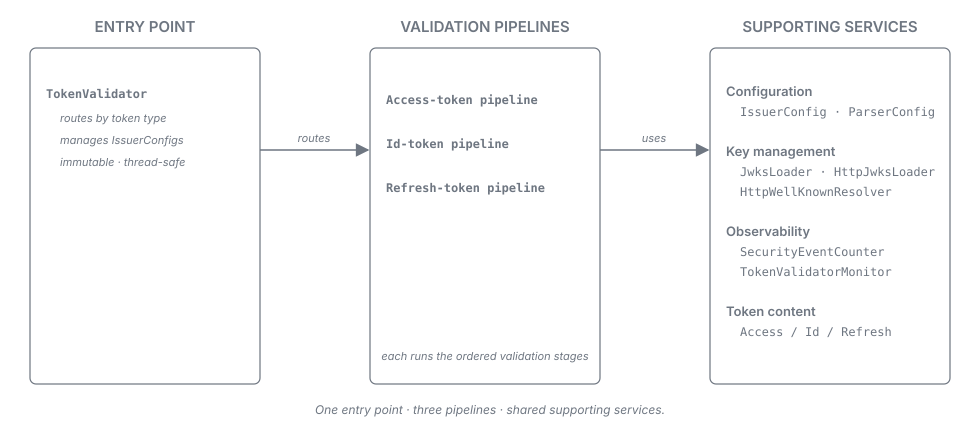
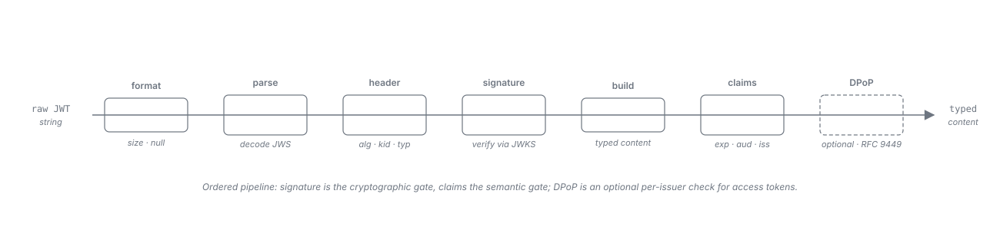
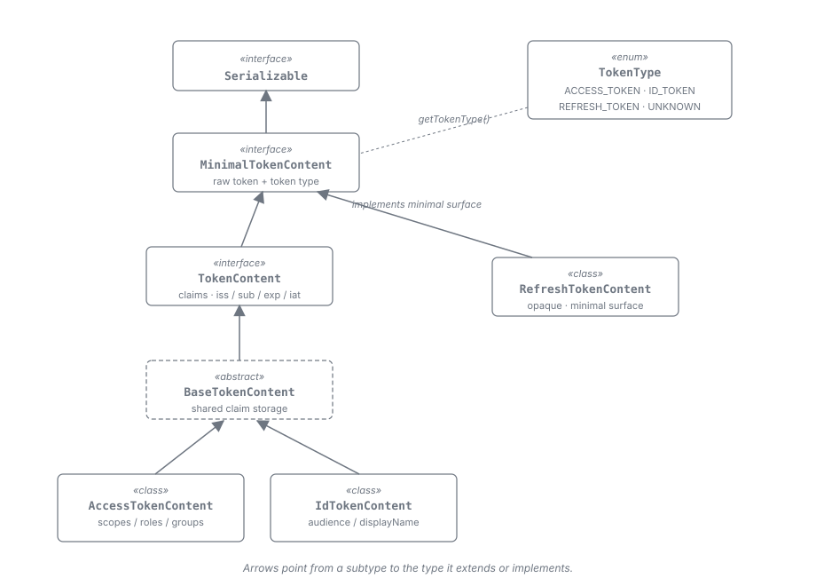
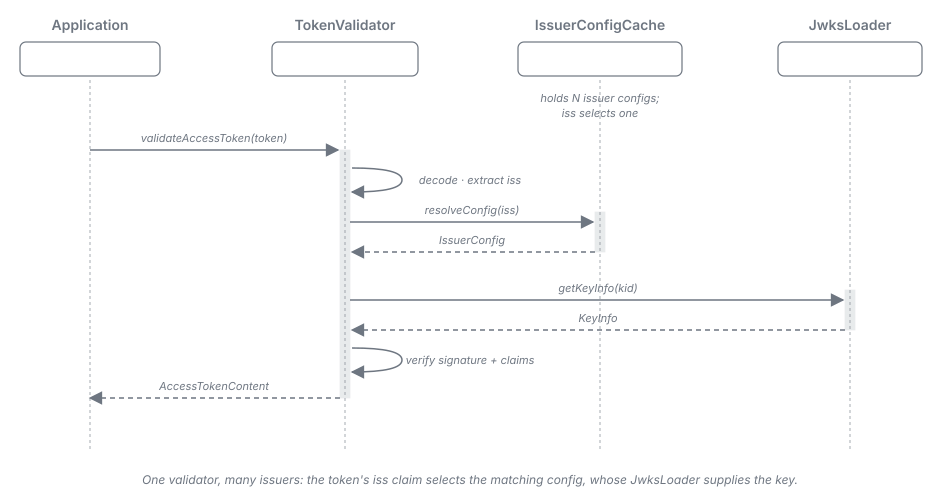
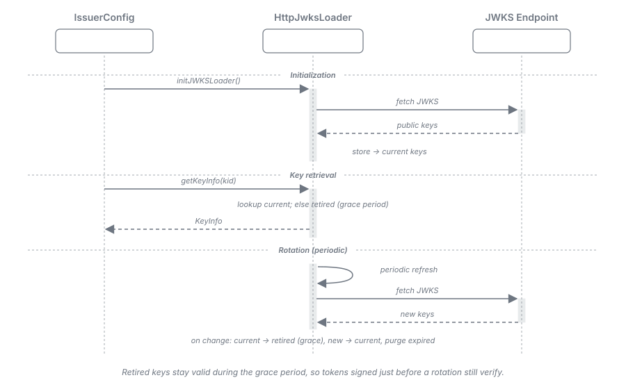

= Token Validation Architecture
:toc: left
:toclevels: 3
:toc-title: Table of Contents
:sectnums:
:source-highlighter: highlight.js

== Overview

Token-Sheriff validates JWT tokens through a multi-stage pipeline. This document describes the core components, their interactions, and key design decisions.

[[token-validation-pipeline]]
== Token Validation Pipeline

_See Requirement xref:requirements.adoc#VALIDATION-1[VALIDATION-1: Token Parsing and Validation]_

The `TokenValidator` is the primary entry point. It processes tokens through an ordered pipeline:

0. **TokenStringValidator** - Pre-pipeline validation (null/blank checks, size limits)
1. **NonValidatingJwtParser** - Decodes token structure without cryptographic validation
2. **TokenHeaderValidator** - Validates algorithm, key ID, embedded JWK protection, optional token type per RFC 9068
3. **TokenSignatureValidator** - Verifies cryptographic signature using JWKS
4. **TokenBuilder** - Creates typed token content objects
5. **TokenClaimValidator** - Validates claims (expiration, audience, issuer, etc.)
6. **DpopProofValidator** - Optional per-issuer DPoP proof validation per RFC 9449 (access tokens only)

When `JweDecryptionConfig` is configured on `TokenValidator`, `NonValidatingJwtParser` transparently handles JWE (5-part) tokens: it decrypts the JWE using `JweDecryptor`, extracts the inner JWS, and feeds it through the existing pipeline. See xref:specification/token-decryption.adoc[Token Decryption] for details.

This pipeline provides separation of concerns, clear error signaling through `TokenValidationException`, and comprehensive security coverage.

=== Exception-based Validation

The pipeline uses `TokenValidationException` for error handling, encapsulating:

* **EventType** - The security event type (integrated with `SecurityEventCounter`)
* **EventCategory** - `INVALID_STRUCTURE`, `INVALID_SIGNATURE`, or `SEMANTIC_ISSUES`
* A detailed error message

== Component Specifications

=== TokenValidator

_See Requirement xref:requirements.adoc#VALIDATION-2[VALIDATION-2: Token Representation]_

The `TokenValidator` manages multiple `IssuerConfig` instances, selects the appropriate configuration for each token, and orchestrates the validation pipeline. It is immutable and thread-safe after construction.

[[token-validator-seams]]
==== Public Seams

_See Requirement xref:requirements.adoc#VALIDATION-13[VALIDATION-13: Public Validation Seams and Back-Channel Logout]_

Beside `createAccessToken`, `createIdToken` and `createRefreshToken`, `TokenValidator` publishes three narrow entries for consumers that build on token validation (xref:../adr/0029-TokenValidator_publishes_signature-only_verification_native_JSON_claims_and_a_non-fetching_issuer_status_view.adoc[ADR-0029]):

[cols="1,1,3", options="header"]
|===
|Member |Returns |Purpose
|`verifySignature(String)` |`SignatureVerifiedToken` |Runs the token string, issuer, header and signature stages of the ID-token pipeline and maps the claims, with no claim verdict. Neither cache nor performance monitor is involved; a success counts `SIGNATURE_ONLY_VERIFIED`. See xref:security-reference.adoc#signature-only-verification[Signature-Only Verification] before relying on the result.
|`getRawClaims(TokenContent)` |`Map<String, Object>` |Decodes the raw token of a validated token again with the validator's own parser and bounds, and returns its payload as deep-immutable native JSON. Nothing is cached; a JWE is decrypted again on every call.
|`getIssuerStatuses()` |`List<IssuerStatusView>` |One read-only view per enabled issuer, in configuration order. Reading a view's status fetches no keys.
|===

Two types carry these results:

* **SignatureVerifiedToken** (`domain.token`) - The mapped claims, the native JSON claims and the verbatim `typ` header of a token whose signature was verified and whose claims were not. It implements neither `TokenContent` nor `MinimalTokenContent`, so it cannot be passed where a validated token is expected, and it is never cached.
* **IssuerStatusView** - The issuer identifier, the JWKS type and the current `LoaderStatus` of one enabled issuer. It holds the loader only to read its status: it exposes neither the `IssuerConfig` nor the `JwksLoader`, so the loaders stay owned by the validator and are closed only by `TokenValidator.close()`.

[[logout-package]]
=== Logout Token Validation

_See Requirements xref:requirements.adoc#VALIDATION-13.4[VALIDATION-13.4: Logout Token Validation] and xref:requirements.adoc#VALIDATION-13.5[VALIDATION-13.5: Logout Token Replay Guard]_

The `logout` package validates logout tokens of https://openid.net/specs/openid-connect-backchannel-1_0.html[OpenID Connect Back-Channel Logout 1.0]. It is built on the public seams above rather than on the token pipelines: a logout token is neither an access token nor an ID token, so no `TokenType` verdict applies to it.

[source]
----
raw logout token
   |
   v
LogoutTokenValidator.validate(rawToken)
   |-- TokenValidator.verifySignature(rawToken) ---> SignatureVerifiedToken   (refused -> SIGNATURE)
   |-- getTypHeader()                                typ check                 (-> TYPE)
   |-- getRawClaims()                                iss, aud, iat, exp,
   |                                                 events, nonce, sub/sid,
   |                                                 jti checks                (-> ISSUER ... JWT_ID)
   |-- LogoutTokenReplayGuard.admit(jti, iat + window)                         (-> REPLAYED / REPLAY_GUARD_FULL)
   v
LogoutTokenValidationResult: accepted claims, or the one failed LogoutTokenCheck
----

* **LogoutTokenValidator** - Built with the `TokenValidator`, the expected issuer and audience, the `iat` freshness window, the replay-guard capacity and a clock. It builds its own replay guard from that capacity and clock, runs the checks in a fixed order and returns the first that fails. It is thread-safe; its only mutable state is the guard it owns.
* **LogoutTokenValidationResult** - For an accepted token, the `iss`, the `jti` and the `sub` and/or `sid` that name the session to end; for a refused token, the single failed check and no claim. Its `toString()` names only the outcome.
* **LogoutTokenCheck** - The bounded set of checks a refusal names. A caller can log or meter it without carrying any text taken from the token.
* **LogoutTokenReplayGuard** - A bounded, fail-closed store of the SHA-256 digests of admitted `jti` values, internal to the package. Each validator builds its own from the configured capacity and the validator's clock, so retention is decided with the same time source that judges `iat`. It is consulted last, so a token refused by any other check takes no capacity.

The package does not log. Receiving the logout request over HTTP and ending the session the token names stay with the consuming application. The checks and their security rationale are in xref:security-reference.adoc#logout-token-validation[Logout Token Validation].

[[token-structure]]
[[token-types]]
=== Token Architecture and Types

_See Requirement xref:requirements.adoc#VALIDATION-1.2[VALIDATION-1.2: Token Types]_

* **TokenContent** / **BaseTokenContent** - Core interface and abstract base for JWT tokens
* **AccessTokenContent** - OAuth2 access token with scope and role support
* **IdTokenContent** - OpenID Connect ID token for user identity
* **UnvalidatedRefreshToken** - Refresh token with minimal validation (implements `MinimalTokenContent`; if JWT-formatted, claims are extracted but no cryptographic signature verification or claim validation is performed)

[[multi-issuer]]
=== IssuerConfig and Multi-Issuer Support

_See Requirement xref:requirements.adoc#VALIDATION-3[VALIDATION-3: Multi-Issuer Support]_

Each `IssuerConfig` holds everything needed to validate tokens from one issuer:

* Issuer identifier - an explicit `issuer-identifier` is the default and recommended form for every issuer, also together with `well-known-url`; `IssuerConfig` and the Quarkus `IssuerConfigResolver` require it (see the enforcement note in xref:requirements.adoc#VALIDATION-3.1[VALIDATION-3.1])
* Expected audience and client ID
* JWKS configuration (HTTP, file, or in-memory)
* Algorithm preferences and custom claim mappers

Configuration validation happens at `build()` time (fail-fast). JwksLoader initialization is a separate phase requiring a `SecurityEventCounter`.

[[jwks-integration]]
=== JwksLoader and Key Management

_See Requirement xref:requirements.adoc#VALIDATION-4[VALIDATION-4: Key Management]_

The `JwksLoader` interface handles retrieval, caching, and rotation of cryptographic keys. Implementations:

* **HttpJwksLoader** - Fetches keys via HTTPS with ETag caching (`ETagAwareHttpAdapter` from cui-http) and resilient retry (`ResilientHttpAdapter` from cui-http). Initialization via `initJWKSLoader()` returns `CompletableFuture<LoaderStatus>` for async startup; key retrieval via `getKeyInfo()` is synchronous.
* **JWKSKeyLoader** - In-memory and file-based key loading.
* **JwksLoaderFactory** - Factory for creating loader instances.

`getKeyIds()` returns an immutable snapshot of the key ids in the active key set; it is empty until keys are loaded. Retired grace-period keys are excluded, so `getKeyInfo()` may still resolve a key id that the snapshot does not list. Callers use the snapshot to compare key sets before and after a refresh.

Key features:

* **Key rotation grace period** (default 5 min) - Retired keys remain valid during transition
* **ETag caching** - `If-None-Match` headers minimize bandwidth
* **Background refresh** - Configurable automatic JWKS refresh
* **Thread-safe** - Lock-free `AtomicReference` for status and content
* **Opt-in maximum staleness** - Off by default. With `HttpJwksLoaderConfig.maxStaleness` set (under Quarkus `sheriff.token.issuers.<name>.jwks.http.max-staleness-seconds`), a refresh cycle that installs no keys while the last successful load is older than the bound moves the loader from `OK` to `UNDEFINED` until a refresh succeeds again (xref:../adr/0017-A_JWKS_loader_reports_OK_only_with_usable_keys_and_retries_only_transient_discovery_failures.adoc[ADR-0017]). The age is measured on the wall clock (`Instant`), so a system-clock jump moves it too.

The issuer cache admits an issuer for validation only while its loader reports `OK`. The access-token pipeline applies this on a cache hit as well: after the cache has enforced the issuer's time policy, `AccessTokenValidationPipeline` resolves the issuer again, so a token cached before its issuer's loader left `OK` — for example past the maximum staleness — is rejected like any other token of that issuer, before the DPoP proof and the custom rules run (xref:../adr/0021-A_cached_token_is_rejected_for_expiry_or_age_inside_the_cache_before_the_DPoP_proof_is_checked.adoc[ADR-0021]).

=== OIDC Discovery

_See Requirement xref:requirements.adoc#VALIDATION-4.1[VALIDATION-4.1: JWKS Endpoint Support]_

`HttpWellKnownResolver` fetches `/.well-known/openid-configuration` documents and caches the result using lock-free `AtomicReference`. The discovered `jwks_uri` is used by `HttpJwksLoader` to fetch public keys.

For every enabled `IssuerConfig` using well-known discovery, the discovered `issuer` field is compared against the `IssuerConfig` identifier. `IssuerConfig` propagates its identifier into the loader configuration when it is built, so the identifier is configured once and need not be repeated on `HttpJwksLoaderConfig`. A mismatch is a hard failure: no keys are loaded, `ISSUER_MISMATCH` is counted, the discovered `jwks_uri` is never fetched, and every token for that issuer is rejected; the configured identifier stays authoritative for issuer matching. A discovery document that advertises a `jwks_uri` but no `issuer` is a terminal rejection as well: no keys are loaded, `ISSUER_MISMATCH` is counted once and the discovered `jwks_uri` is never fetched. A document missing both `issuer` and `jwks_uri` is an unusable response that stays retryable. An identifier on `HttpJwksLoaderConfig` that differs from the `IssuerConfig` identifier, and a pre-built `WELL_KNOWN` loader passed via `jwksLoader(...)` without the same identifier, are rejected when the `IssuerConfig` is built.

Standalone use of `HttpJwksLoaderConfig` without `IssuerConfig` may omit the identifier for well-known discovery; the loader then uses the discovered `issuer` internally and no comparison takes place.

[[securityeventcounter]]
=== SecurityEventCounter

_See Requirement xref:requirements.adoc#VALIDATION-7.3[VALIDATION-7.3: Security Events]_

Thread-safe counter for security events during token processing. Created by `TokenValidator` and passed to all pipeline components and `JwksLoader` implementations. Follows the same naming scheme as `JWTValidationLogMessages` for correlation between logs and metrics.

=== TokenValidatorMonitor

High-performance, lock-free monitoring of validation pipeline metrics with microsecond precision. Measures the validation pipeline steps: `COMPLETE_VALIDATION`, `TOKEN_PARSING`, `ISSUER_EXTRACTION`, `CACHE_LOOKUP`, `ISSUER_CONFIG_RESOLUTION`, `HEADER_VALIDATION`, `SIGNATURE_VALIDATION`, `TOKEN_BUILDING`, `CLAIMS_VALIDATION`, `CACHE_STORE`. Exposed as Micrometer counters in Quarkus (`sheriff.token.validation.errors`, `sheriff.token.validation.success`).

== Size Limits

[cols="1,1,2", options="header"]
|===
|Parameter |Default |Purpose
|`maxTokenSize` (`ParserConfig`) |8 KB |Entire token string of a JWS, and the inner JWS after decryption
|`maxEncryptedTokenSize` (`JweDecryptionConfig`) |32 KB (at most) |Entire string of a 5-part compact JWE, when `JweDecryptionConfig` is configured
|`maxPayloadSize` (`ParserConfig`) |8 KB |Each Base64-decoded header or payload part
|`maxStringLength` (`ParserConfig`) |4 KB |Individual JSON string values (DSL-JSON enforced)
|`maxHttpResponseSize` (`ParserConfig`) |256 KB |Response body of a JWKS or well-known discovery fetch, enforced while the body streams
|===

With JWE decryption configured, the size check that `TokenStringValidator` and `NonValidatingJwtParser` apply follows the effective limit of the token's shape: a 5-part compact token is checked against `maxEncryptedTokenSize`, so a JWE of up to that limit passes the parser, while a 3-part JWS and the inner JWS after decryption keep `maxTokenSize`. The check on the token string runs in all three pipelines (access, ID and refresh token). A token string above its limit is refused as a counted `TOKEN_SIZE_EXCEEDED` `TokenValidationException`. The one exception is the inner JWS of a JWE refresh token: a refresh token is decoded opaquely (`NonValidatingJwtParser.decodeOpaqueToken`), which neither logs nor counts, so an oversized inner JWS is not counted as `TOKEN_SIZE_EXCEEDED`; the refresh pipeline returns the token with empty claims instead of rejecting it. `maxPayloadSize` bounds token parts only. The JWKS and discovery fetches are bounded in bytes by `maxHttpResponseSize` alone, and the JSON they carry is additionally bounded by `maxStringLength`, the DSL-JSON limit on each string value, which the same `ParserConfig` applies to the parsed response bodies.

== References

* xref:requirements.adoc[Requirements]
* xref:security-reference.adoc[Security Reference]
* xref:specification/token-decryption.adoc[Token Decryption (JWE)]
* xref:../adr/0029-TokenValidator_publishes_signature-only_verification_native_JSON_claims_and_a_non-fetching_issuer_status_view.adoc[ADR-0029: TokenValidator public seams]
