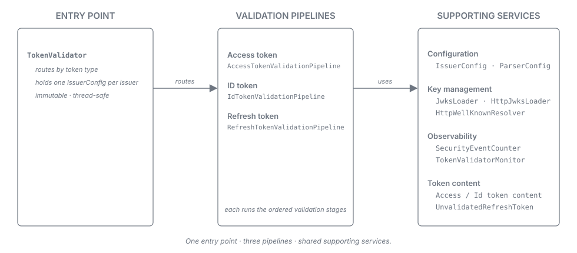
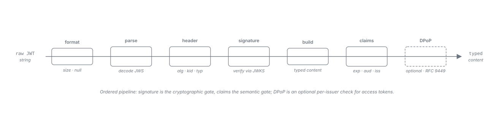
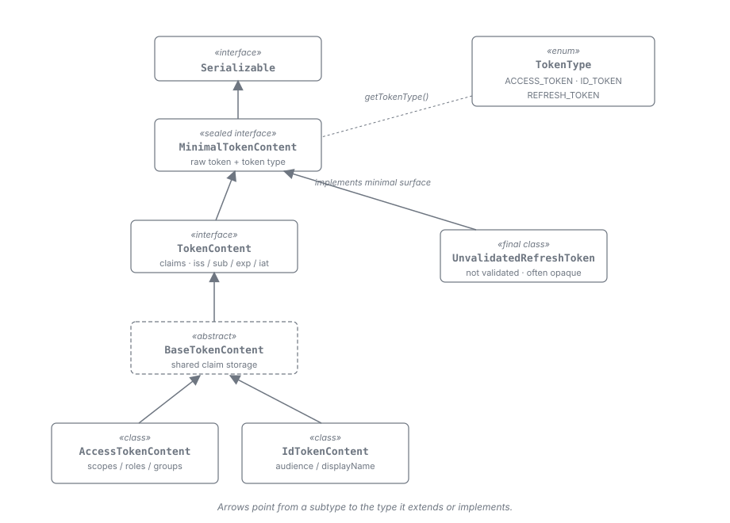
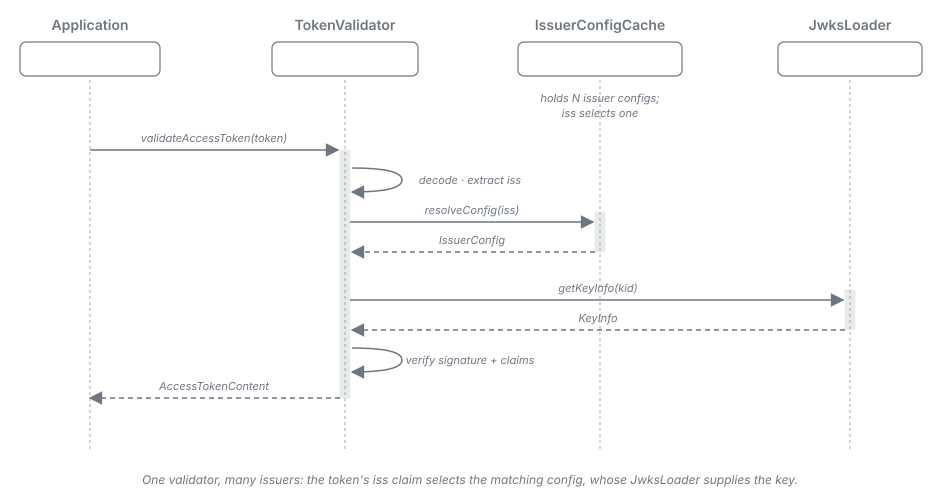
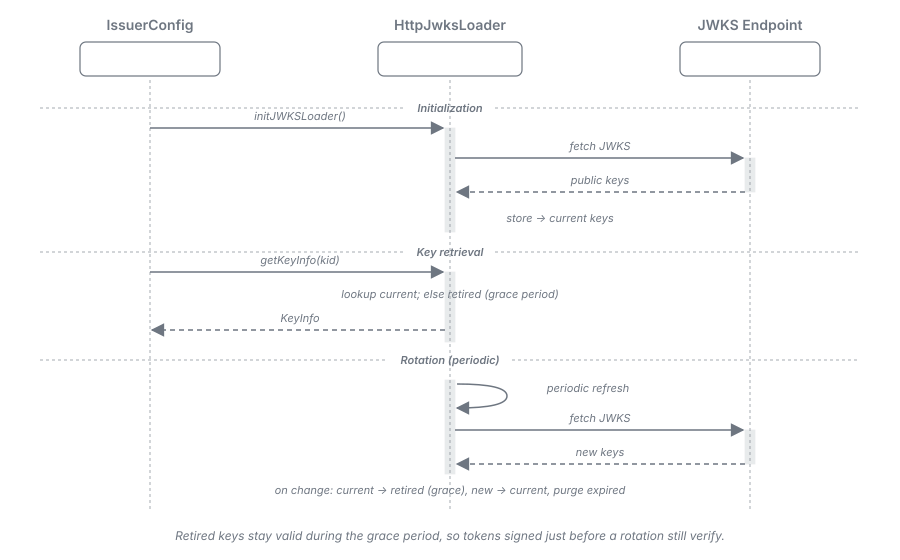

= Token Validation Architecture
:toc: left
:toclevels: 3
:toc-title: Table of Contents
:sectnums:
:source-highlighter: highlight.js

== Overview

Token-Sheriff validates JWT tokens through a multi-stage pipeline. This document describes the core components, their interactions, and key design decisions.

[[token-validation-pipeline]]
== Token Validation Pipeline

_See Requirement xref:requirements.adoc#VALIDATION-1[VALIDATION-1: Token Parsing and Validation]_

The `TokenValidator` is the primary entry point. It processes tokens through an ordered pipeline:

0. **TokenStringValidator** - Pre-pipeline validation (null/blank checks, size limits)
1. **NonValidatingJwtParser** - Decodes token structure without cryptographic validation
2. **TokenHeaderValidator** - Validates algorithm, key ID, embedded JWK protection, optional token type per RFC 9068
3. **TokenSignatureValidator** - Verifies cryptographic signature using JWKS
4. **TokenBuilder** - Creates typed token content objects
5. **TokenClaimValidator** - Validates claims (expiration, audience, issuer, etc.)
6. **DpopProofValidator** - Optional per-issuer DPoP proof validation per RFC 9449 (access tokens only)

When `JweDecryptionConfig` is configured on `TokenValidator`, `NonValidatingJwtParser` transparently handles JWE (5-part) tokens: it decrypts the JWE using `JweDecryptor`, extracts the inner JWS, and feeds it through the existing pipeline. See xref:specification/token-decryption.adoc[Token Decryption] for details.

[[access-token-cache]]
=== Access-Token Cache

`AccessTokenCache` returns a previously validated access token without repeating signature and claim validation. A hit must never return a token whose time-based validity has lapsed, so the two checks whose answer changes with the clock — expiry and maximum token age — are re-applied by the cache itself. The cache is not equivalent to a fresh validation in one respect: a hit does not verify the signature again, so a token whose signing key has left the loader's active and retired key sets stays accepted from the cache while the issuer's loader remains `OK` (the hit only re-checks the loader status), whereas an uncached validation of the same token is rejected. The window ends when the token expires or is evicted.

* *Per-entry time policy.* `AccessTokenCache.put` receives the per-issuer `ValidationContext` the token was validated with and stores that issuer's clock skew and maximum token age on the entry, next to the expiry. The policy is captured at store time and not refreshed when the issuer configuration is read again (issuer configurations are fixed at validator construction). Issuers with different tolerances therefore share one cache without weakening each other, and the background eviction applies each entry's own policy without any request or issuer context.
* *No `iat`-less token under a maximum age.* When the issuer enforces a maximum token age, a token without `iat` is not cached. The pipeline already rejects it with `MISSING_CLAIM` (`ExpirationValidator.validateTokenAge`) before it stores anything; the refusal in `put` is defence in depth, so a future path that stored a token without the full claim validation still could not bypass the bound. Without a maximum token age such a token is cached as usual.
* *Rejection inside the lookup.* `AccessTokenCache.get` evaluates a verified hit against the stored policy. An entry expired under its issuer's clock skew is removed and the lookup throws `TOKEN_EXPIRED`; an entry older than the maximum token age plus clock skew is removed and the lookup throws `TOKEN_AGE_EXCEEDED`. Each rejection is logged and counted. The cache never returns an invalid entry, so no caller can forget the check; the lookup is a validation step, not a plain map read.
* *Order on a hit.* time policy, then issuer re-resolution (rejects a token whose issuer's loader is no longer `OK`), then the DPoP proof, then the custom rules. As on the uncached path, the time checks run before the DPoP proof, so the proof — and its `jti` record in the replay store — is never checked for a token the time checks reject. The uncached path resolves the issuer before it validates the claims, so a token that is both expired and from an issuer whose loader left `OK` is reported `TOKEN_EXPIRED` / `TOKEN_AGE_EXCEEDED` on a hit and as the issuer rejection on a miss; both paths reject it.

=== Exception-based Validation

The pipeline uses `TokenValidationException` for error handling, encapsulating:

* **EventType** - The security event type (integrated with `SecurityEventCounter`)
* **EventCategory** - `INVALID_STRUCTURE`, `INVALID_SIGNATURE`, or `SEMANTIC_ISSUES`
* A detailed error message

== Component Specifications

=== TokenValidator

_See Requirement xref:requirements.adoc#VALIDATION-2[VALIDATION-2: Token Representation]_

The `TokenValidator` manages multiple `IssuerConfig` instances, selects the appropriate configuration for each token, and orchestrates the validation pipeline. It is immutable and thread-safe after construction.

[[token-validator-ownership]]
==== Loader Ownership and `close()`

The validator owns the JWKS loaders of the enabled issuer configs it is built from. At construction it retains those loaders; `close()` shuts down the access-token pipeline and the DPoP replay protection and then closes every retained loader that is `AutoCloseable`, which stops its background refresh and releases an executor the loader owns. A loader that is not `AutoCloseable` is skipped. An `Exception` thrown while closing one loader is logged at debug level and does not stop the remaining loaders; an interrupted close restores the thread's interrupt flag and still closes the remaining loaders. An `Error` thrown by a loader's close is not caught, so it propagates and the loaders after it stay open.

Consequence for callers: an `IssuerConfig`, or a pre-built JWKS loader set on it, must not be shared with a validator that outlives the one it was passed to. Closing a loader stops its refresh, clears its keys and resets its status to `UNDEFINED`, so a validator still using a shared loader can no longer verify signatures for that issuer, and a loader that owns its executor cannot be initialised again. The Quarkus producer closes the validator it created on destruction (see xref:../../token-sheriff-quarkus-parent/doc/integration/quarkus-integration.adoc#validator-disposal[Quarkus integration]).

[[token-validator-seams]]
==== Public Seams

_See Requirement xref:requirements.adoc#VALIDATION-10[VALIDATION-10: Public Validation Seams and Back-Channel Logout]_

Beside `createAccessToken`, `createIdToken` and `createRefreshToken`, `TokenValidator` publishes three narrow entries for consumers that build on token validation (xref:../adr/0029-TokenValidator_publishes_signature-only_verification_native_JSON_claims_and_a_non-fetching_issuer_status_view.adoc[ADR-0029]):

[cols="1,1,3", options="header"]
|===
|Member |Returns |Purpose
|`verifySignature(String)` |`SignatureVerifiedToken` |Runs the token string, issuer, header and signature stages of the ID-token pipeline and maps the claims, with no claim verdict. Neither cache nor performance monitor is involved; a success counts `SIGNATURE_ONLY_VERIFIED`. See xref:security-reference.adoc#signature-only-verification[Signature-Only Verification] before relying on the result.
|`getRawClaims(TokenContent)` |`Map<String, Object>` |Decodes the raw token of a validated token again with the validator's own parser and bounds, and returns its payload as deep-immutable native JSON. Nothing is cached; a JWE is decrypted again on every call.
|`getIssuerStatuses()` |`List<IssuerStatusView>` |One read-only view per enabled issuer, in configuration order. Reading a view's status fetches no keys.
|===

Two types carry these results:

* **SignatureVerifiedToken** (`domain.token`) - The mapped claims, the native JSON claims and the verbatim `typ` header of a token whose signature was verified and whose claims were not. It implements neither `TokenContent` nor `MinimalTokenContent`, so it cannot be passed where a validated token is expected, and it is never cached.
* **IssuerStatusView** - The issuer identifier, the JWKS type and the current `LoaderStatus` of one enabled issuer. It holds the loader only to read its status: it exposes neither the `IssuerConfig` nor the `JwksLoader`, so the loaders stay owned by the validator and are closed only by `TokenValidator.close()`.

Constraints on these seams:

* `verifySignature` runs the string limits, parse (including JWE decryption), `iss` extraction, issuer resolution, header posture, signature and claim mapping — a sibling method of `IdTokenValidationPipeline`, which keeps its own steps. It does not apply the issuer's configured `expectedTokenType`, so one issuer's keys can verify several token types; the `typ` header is returned verbatim for the caller to judge, and every other header check (algorithm allow-list, `kid`, embedded-`jwk` refusal) still applies. It neither reads nor writes the access-token cache. A refusal counts exactly the event of the stage that refused it.
* The native claim map is deep-immutable: objects as unmodifiable insertion-ordered maps, arrays as unmodifiable lists, scalars unchanged, nested `null` kept, a top-level `null` member dropped (`SignatureVerifiedToken#getNullClaimNames()` reports it). `SignatureVerifiedToken` retains the map; validated tokens do not, so `BaseTokenContent`, `AccessTokenContent` and the cached entries gain no field.
* The JWKS readiness probe uses `getIssuerStatuses()` for an embedder-supplied validator only when `sheriff.token.health.jwks.report-external-validator=true` (default `false`, because a real status can turn an embedder's readiness `DOWN`), and `sheriff.token.health.jwks.disclose-issuer=false` (default `true`) omits the per-issuer `issuer.N.url` entries.

[[logout-package]]
=== Logout Token Validation

_See Requirements xref:requirements.adoc#VALIDATION-10.4[VALIDATION-10.4: Logout Token Validation] and xref:requirements.adoc#VALIDATION-10.5[VALIDATION-10.5: Logout Token Replay Guard]_

The `logout` package validates logout tokens of https://openid.net/specs/openid-connect-backchannel-1_0.html[OpenID Connect Back-Channel Logout 1.0]. It is built on the public seams above rather than on the token pipelines: a logout token is neither an access token nor an ID token, so no `TokenType` verdict applies to it.

[source]
----
raw logout token
   |
   v
LogoutTokenValidator.validate(rawToken)
   |-- TokenValidator.verifySignature(rawToken) ---> SignatureVerifiedToken   (refused -> SIGNATURE;
   |                                                                           unmappable iat -> ISSUED_AT,
   |                                                                           unmappable exp -> EXPIRATION)
   |-- now = clock.instant()                         read once per token
   |-- getTypHeader()                                typ check                 (-> TYPE)
   |-- getRawClaims(), getNullClaimNames()           iss, aud, iat, exp,
   |                                                 events, nonce, sub/sid,
   |                                                 jti checks at now         (-> ISSUER ... JWT_ID)
   |-- LogoutTokenReplayGuard.admit(jti, iat + window, now)                    (-> REPLAYED / REPLAY_GUARD_FULL)
   v
LogoutTokenValidationResult: accepted claims, or the one failed LogoutTokenCheck
----

A claim the signature-only entry cannot map refuses the token before the claim checks run. A present `iat` or `exp` that is not a number keeps the identity of its check, `ISSUED_AT` or `EXPIRATION`; any other unmappable claim, a `sub` that is a JSON number, boolean, array or object among them, is refused as `SIGNATURE`.

* **LogoutTokenValidator** - Built with the `TokenValidator`, the expected issuer and audience, the `iat` freshness window, the replay-guard capacity and a clock. It builds its own replay guard from that capacity, reads the clock once per token, runs the checks in a fixed order against that instant and returns the first that fails. It is thread-safe; its only mutable state is the guard it owns.
* **LogoutTokenValidationResult** - For an accepted token, the `iss`, the `jti` and the `sub` and/or `sid` that name the session to end; for a refused token, the single failed check and no claim. Its `toString()` names only the outcome.
* **LogoutTokenCheck** - The bounded set of checks a refusal names. A caller can log or meter it without carrying any text taken from the token.
* **LogoutTokenReplayGuard** - A bounded, fail-closed store of the SHA-256 digests of admitted `jti` values, internal to the package. Each validator builds its own from the configured capacity. The guard reads no clock: every admission passes the one instant the validator judged `iat` against, so purge and freshness are decided on the same instant and two clock reads cannot straddle the `iat` plus window edge. It is consulted last, so a token refused by any other check takes no capacity.

The package does not log. Receiving the logout request over HTTP and ending the session the token names stay with the consuming application. The checks and their security rationale are in xref:security-reference.adoc#logout-token-validation[Logout Token Validation].

[[token-structure]]
[[token-types]]
=== Token Architecture and Types

_See Requirement xref:requirements.adoc#VALIDATION-1.2[VALIDATION-1.2: Token Types]_

* **TokenContent** / **BaseTokenContent** - Core interface and abstract base for JWT tokens
* **AccessTokenContent** - OAuth2 access token with scope and role support
* **IdTokenContent** - OpenID Connect ID token for user identity
* **UnvalidatedRefreshToken** - Refresh token with minimal validation (implements `MinimalTokenContent`; if JWT-formatted, claims are extracted but no cryptographic signature verification or claim validation is performed)

[[multi-issuer]]
=== IssuerConfig and Multi-Issuer Support

_See Requirement xref:requirements.adoc#VALIDATION-3[VALIDATION-3: Multi-Issuer Support]_

Each `IssuerConfig` holds everything needed to validate tokens from one issuer:

* Issuer identifier - an explicit `issuer-identifier` is the default and recommended form for every issuer, also together with `well-known-url`; `IssuerConfig` and the Quarkus `IssuerConfigResolver` require it (see the enforcement note in xref:requirements.adoc#VALIDATION-3.1[VALIDATION-3.1])
* Expected audience and client ID
* JWKS configuration (HTTP, file, or in-memory)
* Algorithm preferences and custom claim mappers

Configuration validation happens at `build()` time (fail-fast). JwksLoader initialization is a separate phase requiring a `SecurityEventCounter`.

[[jwks-integration]]
=== JwksLoader and Key Management

_See Requirement xref:requirements.adoc#VALIDATION-4[VALIDATION-4: Key Management]_

The `JwksLoader` interface handles retrieval, caching, and rotation of cryptographic keys. Implementations:

* **HttpJwksLoader** - Fetches keys via HTTPS with ETag caching (`ETagAwareHttpAdapter` from cui-http) and resilient retry (`ResilientHttpAdapter` from cui-http). Initialization via `initJWKSLoader()` returns `CompletableFuture<LoaderStatus>` for async startup; key retrieval via `getKeyInfo()` is synchronous.
* **JWKSKeyLoader** - In-memory and file-based key loading.
* **JwksLoaderFactory** - Factory for creating loader instances.

`getKeyIds()` returns an immutable snapshot of the key ids in the active key set; it is empty until keys are loaded. Retired grace-period keys are excluded, so `getKeyInfo()` may still resolve a key id that the snapshot does not list. Callers use the snapshot to compare key sets before and after a refresh.

Key features:

* **Key rotation grace period** (default 5 min) - Retired keys remain valid during transition
* **ETag caching** - `If-None-Match` headers minimize bandwidth
* **Background refresh** - Configurable automatic JWKS refresh
* **Thread-safe** - Lock-free `AtomicReference` for status and content
* **Opt-in maximum staleness** - Off by default. With `HttpJwksLoaderConfig.maxStaleness` set (under Quarkus `sheriff.token.issuers.<name>.jwks.http.max-staleness-seconds`), a refresh cycle that installs no keys while the last successful load is older than the bound moves the loader from `OK` to `UNDEFINED` until a refresh succeeds again (xref:../adr/0017-A_JWKS_loader_reports_OK_only_with_usable_keys_and_retries_only_transient_discovery_failures.adoc[ADR-0017]). The age is measured on the wall clock (`Instant`), so a system-clock jump moves it too.
* **Opt-in unknown key ID refresh** - Off by default. With `HttpJwksLoaderConfig.unknownKidRefreshWindow` set to 5 to 3600 seconds (under Quarkus `sheriff.token.issuers.<name>.jwks.http.unknown-kid-refresh-window-seconds`), once a key set is installed, a `getKeyInfo()` call whose `kid` misses the installed and the retired key sets claims the window with one compare-and-set on a monotonic clock and schedules one background fetch on the loader's refresh executor. The lookup itself performs no I/O, does not wait and still misses, so the triggering token is rejected; once the fetch has installed the new key set, the next token naming that `kid` is accepted. The fetched key set is installed only if it holds the triggering `kid`; a failed or non-matching fetch changes nothing (keys, retired sets, status, endpoint and the time of the last successful load) and is not counted as a failed refresh cycle, so it never contributes to re-discovery or to the maximum-staleness degradation. At most one such fetch runs per window and per loader (xref:requirements.adoc#VALIDATION-4.6[VALIDATION-4.6]).
* **Opt-in initial load retry** - Off by default. With `HttpJwksLoaderConfig.initialLoadRetry(true)` (under Quarkus `sheriff.token.issuers.<name>.jwks.http.initial-load-retry`), an initial load that ends without installed keys is retried on the loader's refresh executor after 1 second, the delay doubling up to 30 seconds and never above the refresh interval. Each attempt runs the regular background refresh cycle, so a failed discovery is re-resolved and a terminal rejection stays terminal; retries stop at the first installed key set, at `ERROR` and at `close()`, and the status never reports `LOADING` (xref:requirements.adoc#VALIDATION-4.7[VALIDATION-4.7]).

The periodic refresh, the unknown key ID refresh and the initial load retry share one in-flight guard, so their fetches never overlap; while the guard is held, a periodic cycle skips its fetch without counting it as failed. All three install a key set through the same commit step under the lifecycle lock, which re-checks the generation epoch, applies the grace period and the retired-set bound, so a loader closed meanwhile installs nothing (xref:#jwks-lifecycle[]). The design and its bounds are recorded in xref:../adr/0030-An_opt-in_unknown-kid_refresh_claims_one_window_per_loader_and_installs_only_a_key_set_holding_the_kid.adoc[ADR-0030].

Further rules of the unknown key ID refresh: a miss first reads the window and returns at once, taking nothing, while the window is still claimed; only then does it take the in-flight guard and claim the window, and a lost claim releases the guard. A hand-off the executor rejects, or fails with another `RuntimeException`, releases the guard, is logged at DEBUG and never thrown on the lookup, and burns the window. A caller-supplied executor must run or reject every task it accepts: an accepted and silently discarded fetch leaves the guard held, after which every periodic fetch skips. A fetch that returns the installed key set unchanged is logged at DEBUG, not as `UNKNOWN_KID_REFRESH_DISCARDED`. Both opt-ins require background refresh: `build()` refuses a configured window, or `initialLoadRetry(true)`, together with a refresh interval of 0. Known limitation: a periodic cycle that skips because the guard is held also skips its `maxStaleness` evaluation; with a caller-supplied multi-thread executor and a slow identity provider, a caller who claims every window can keep deferring the staleness degradation. Any other `RuntimeException` of the adapter or key-set build during an on-demand fetch is caught, so it cannot escape unsanitised onto the executor worker (CWE-117), and the outcome is discarded like any other.

The issuer cache admits an issuer for validation only while its loader reports `OK`. The access-token pipeline applies this on a cache hit as well: after the cache has enforced the issuer's time policy, `AccessTokenValidationPipeline` resolves the issuer again, so a token cached before its issuer's loader left `OK` — for example past the maximum staleness — is rejected like any other token of that issuer, before the DPoP proof and the custom rules run (xref:#access-token-cache[]).

[[jwks-status-contract]]
==== Loader Status Contract

`LoaderStatus.OK` is reported only while a usable key set is installed; the issuer cache and the readiness probe act on that one fact.

* The first load publishes `OK` only when a usable key set is installed; a fetch that succeeds at the HTTP level but yields no usable key, or no content, is a failed load.
* A failed initialisation publishes `UNDEFINED` ("a refresh cycle will retry") only when background refresh is enabled, a cycle can recover (an endpoint is published, or the loader uses well-known discovery) and the refresh task of this initialisation is actually scheduled and active; otherwise it ends in a terminal `ERROR`. The status is never left at `LOADING`, and an `OK` or `ERROR` a refresh cycle published meanwhile is kept. On the retryable discovery path `UNDEFINED` is published before the task is scheduled; an executor rejection there is corrected to `ERROR`.
* A failed refresh cycle never downgrades an existing `OK`, except under the opt-in `maxStaleness` above. A refresh that yields no usable key never publishes `OK`.

Endpoint resolution for well-known discovery:

* *Retryable* (status stays `UNDEFINED`, each refresh cycle re-attempts the discovery): a transport failure, an error response, a blocked discovery endpoint, or a document that is unreadable or has no `jwks_uri`.
* *Terminal rejection* (`ERROR`, no retry, a refresh task meeting it is cancelled): an advertised issuer that does not match, a document with a `jwks_uri` but no `issuer`, a JWKS URI the egress guard blocks, and an advertised `jwks_uri` for which no HTTP handler can be built (malformed, a scheme other than `http`/`https`, or cleartext while insecure HTTP is not allowed) — the last logged once as `JWKS_URI_UNUSABLE` without echoing the URI.
* With background refresh disabled every resolution failure is a terminal `ERROR`.
* *Re-discovery.* With an endpoint installed, after three consecutive refresh cycles that installed no keys the next cycle re-runs the discovery under the same issuer gate and egress guard. An accepted re-discovery replaces the endpoint and fetches from it; an unavailable one keeps the endpoint. A rejected one is not terminal while an endpoint is installed: endpoint, keys, status and refresh task are kept, and further re-discovery is suppressed until a refresh succeeds or the endpoint has failed three further cycles. The bound is fixed.

The readiness check reports a loader healthy only with `OK`; while any loader is `UNDEFINED` it reports `loading` as `IN_PROGRESS`, and a terminal `ERROR` reports `NOT_READY` with `loading` `COMPLETE`.

[[jwks-lifecycle]]
==== Loader Lifecycle Lock and Generation Epoch

`HttpJwksLoader` runs its initialisation and refresh on threads the caller does not control, and their blocking fetches can outlive a `close()` or a later re-initialisation. Stale work is fenced by:

* *One lifecycle lock.* `close()`, the initialisation claim, key installation, status and endpoint publication and refresh scheduling all hold the same lock, so "still live" and "publish" are one atomic step. The lock is never held across a network call.
* *A generation epoch.* `close()` increments the epoch under the lock. An initialisation captures the epoch it was claimed under, and the refresh task it schedules carries that value, fixed at scheduling. Work is live only while the loader is open and its epoch is current.
* *An immutable endpoint snapshot.* The adapter and the fetch URI of one resolution are one immutable record published with one reference write, so the URI the egress guard re-checks is the URI that is fetched. It is `null` before the first resolution and after `close()`.
* *Stale work publishes nothing.* It installs no keys, publishes no status or endpoint and schedules no task; an initialisation superseded by `close()` completes with `UNDEFINED`. The one bounded exception: a `close()` landing between the liveness check and a blocking fetch lets that fetch go out, and its result is discarded.
* *Claim before acting.* Only the caller that wins the initialisation claim starts the asynchronous work; concurrent callers receive the same future, so at most one initial fetch and one refresh task exist per initialisation.

A loader that owns its refresh executor cannot be initialised again after `close()`; that initialisation is rejected explicitly.

[[oidc-discovery]]
=== OIDC Discovery

_See Requirement xref:requirements.adoc#VALIDATION-4.1[VALIDATION-4.1: JWKS Endpoint Support]_

`HttpWellKnownResolver` fetches `/.well-known/openid-configuration` documents and caches the result using lock-free `AtomicReference`. The discovered `jwks_uri` is used by `HttpJwksLoader` to fetch public keys.

For every enabled `IssuerConfig` using well-known discovery, the discovered `issuer` field is compared against the `IssuerConfig` identifier. `IssuerConfig` propagates its identifier into the loader configuration when it is built, so the identifier is configured once and need not be repeated on `HttpJwksLoaderConfig`. A mismatch is a hard failure: no keys are loaded, `ISSUER_MISMATCH` is counted, the discovered `jwks_uri` is never fetched, and every token for that issuer is rejected; the configured identifier stays authoritative for issuer matching. A discovery document that advertises a `jwks_uri` but no `issuer` is a terminal rejection as well: no keys are loaded, `ISSUER_MISMATCH` is counted once and the discovered `jwks_uri` is never fetched. A document missing both `issuer` and `jwks_uri` is an unusable response that stays retryable. An identifier on `HttpJwksLoaderConfig` that differs from the `IssuerConfig` identifier, and a pre-built `WELL_KNOWN` loader passed via `jwksLoader(...)` without the same identifier, are rejected when the `IssuerConfig` is built.

Standalone use of `HttpJwksLoaderConfig` without `IssuerConfig` may omit the identifier for well-known discovery; the loader then uses the discovered `issuer` internally and no comparison takes place.

[[jws-algorithm-catalog]]
=== JWS Algorithm Catalog

`de.cuioss.sheriff.token.validation.security.JwsAlgorithm` is the single definition of the signing-algorithm facts — key type, digest and, where single-valued, the JCA signature algorithm name and the PSS parameters (xref:../adr/0009-Single_JWS_algorithm_catalog_with_per-consumer_EC_format_composition.adoc[ADR-0009]). Every consumer that signs or verifies derives from it, including the client's DPoP proof generation across the module boundary; `RejectedAlgorithms` is the companion definition of the algorithms that are never accepted.

* *EC carve-out.* For EC entries the catalog supplies no JCA name. JOSE encodes an ECDSA signature as fixed-width `R || S` (P1363), `java.security.Signature` defaults to DER, so each consumer composes the name its wire format needs at its own call site, and both call sites state why.
* *JWK admission is separate.* Which key material a JWKS may offer is governed by its own list (`JwkAlgorithmPreferences`), not derived from the catalog, so adding a signing algorithm never widens what a remote endpoint may supply.
* *Shape.* Shared literals live in a nested private type, because enum constant arguments cannot reference fields of the same enum.
* *Tests.* Test inputs may be derived from the catalog only where that widens coverage; explicit negative cases outside the catalog are kept, each entry's values are pinned explicitly, and a verification oracle never derives its expectation from the catalog.

[[securityeventcounter]]
=== SecurityEventCounter

_See Requirement xref:requirements.adoc#VALIDATION-7.3[VALIDATION-7.3: Security Events]_

Thread-safe counter for security events during token processing. Created by `TokenValidator` and passed to all pipeline components and `JwksLoader` implementations. Follows the same naming scheme as `JWTValidationLogMessages` for correlation between logs and metrics.

=== TokenValidatorMonitor

High-performance, lock-free monitoring of validation pipeline metrics with microsecond precision. Measures the validation pipeline steps: `COMPLETE_VALIDATION`, `TOKEN_PARSING`, `ISSUER_EXTRACTION`, `CACHE_LOOKUP`, `ISSUER_CONFIG_RESOLUTION`, `HEADER_VALIDATION`, `SIGNATURE_VALIDATION`, `TOKEN_BUILDING`, `CLAIMS_VALIDATION`, `CACHE_STORE`. Exposed as Micrometer counters in Quarkus (`sheriff.token.validation.errors`, `sheriff.token.validation.success`).

== Size Limits

[cols="1,1,2", options="header"]
|===
|Parameter |Default |Purpose
|`maxTokenSize` (`ParserConfig`) |8 KB |Entire token string of a JWS, and the inner JWS after decryption
|`maxEncryptedTokenSize` (`JweDecryptionConfig`) |32 KB (at most) |Entire string of a 5-part compact JWE, when `JweDecryptionConfig` is configured
|`maxPayloadSize` (`ParserConfig`) |8 KB |Each Base64-decoded header or payload part
|`maxStringLength` (`ParserConfig`) |4 KB |Individual JSON string values (DSL-JSON enforced)
|`maxHttpResponseSize` (`ParserConfig`) |256 KB |Response body of a JWKS or well-known discovery fetch, enforced while the body streams
|===

With JWE decryption configured, the size check that `TokenStringValidator` and `NonValidatingJwtParser` apply follows the effective limit of the token's shape: a 5-part compact token is checked against `maxEncryptedTokenSize`, so a JWE of up to that limit passes the parser, while a 3-part JWS and the inner JWS after decryption keep `maxTokenSize`. The check on the token string runs in all three pipelines (access, ID and refresh token). A token string above its limit is refused as a counted `TOKEN_SIZE_EXCEEDED` `TokenValidationException`. The one exception is the inner JWS of a JWE refresh token: a refresh token is decoded opaquely (`NonValidatingJwtParser.decodeOpaqueToken`), which neither logs nor counts, so an oversized inner JWS is not counted as `TOKEN_SIZE_EXCEEDED`; the refresh pipeline returns the token with empty claims instead of rejecting it. `maxPayloadSize` bounds token parts only. The JWKS and discovery fetches are bounded in bytes by `maxHttpResponseSize` alone, and the JSON they carry is additionally bounded by `maxStringLength`, the DSL-JSON limit on each string value, which the same `ParserConfig` applies to the parsed response bodies.

== References

* xref:requirements.adoc[Requirements]
* xref:security-reference.adoc[Security Reference]
* xref:specification/token-decryption.adoc[Token Decryption (JWE)]
* xref:../adr/0029-TokenValidator_publishes_signature-only_verification_native_JSON_claims_and_a_non-fetching_issuer_status_view.adoc[ADR-0029: TokenValidator public seams]
